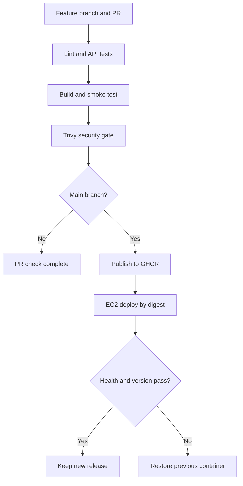

# Intermediate GitHub Actions CI/CD lab: Order API → GHCR → Ubuntu EC2

This is an executable learning project for a DevOps engineer with 3+ years of experience. Follow the numbered stages in order. You will build a stateful REST API, prove correctness with integration tests, package it once, block vulnerable images, publish to GitHub Container Registry (GHCR), and deploy the exact image digest on EC2 with rollback.

**Chosen scope:** Python 3.12 + FastAPI + SQLite WAL + Docker + GitHub Actions + one Ubuntu 24.04 x86_64 EC2 instance. GHCR is the image registry; no ECR, Kubernetes, or AWS access keys are required. SQLite is an intentional single-instance lab choice. The application and deployment are complete within this scope, not a highly available production platform.

**Verified during preparation:** 16 tests passed; application statement/branch coverage 100%; Ruff lint passed; deployment shell scripts passed syntax checks. Docker is unavailable in the preparation environment: container builds, Trivy results, GitHub runs, EC2 installation and real rollback have NOT been executed. A deprecation warning from the installed Starlette TestClient/httpx combination is currently non-fatal. Requirements include exact tested package versions and transitive dependencies, without artifact hashes.

## 1. Understand what you are building

| Stage | Where it runs | Gate or result |
|---|---|---|
| Pull request | GitHub-hosted Ubuntu runner | Lint, API tests, concurrency tests, ≥85% coverage |
| Container build | GitHub-hosted Ubuntu runner | Multi-stage Docker build with non-root runtime |
| Container smoke | Same hosted runner | Live endpoint, DB readiness, exact commit version |
| Security scan | Same hosted runner | Trivy blocks HIGH/CRITICAL findings, including unfixed findings |
| Publish on main | Same hosted runner | Push already-tested image to GHCR; capture immutable digest |
| Deploy on main | Dedicated EC2 self-hosted runner | Pull digest, preserve old container, start new release |
| Verify | EC2 | HTTP readiness and version checks; automatic container rollback on failure |



The code handles:
- Creating, listing, reading and cancelling orders.
- API-key authentication and request validation.
- Integer paise for money, avoiding floating-point currency errors.
- Transactional idempotency: the same request/key returns the same order; different data with the same key returns HTTP 409.
- Concurrent retries: a database transaction and unique constraint prevent duplicate insertion.
- Persistent named-volume storage, readiness checks, request IDs and structured application logs.

Repository contents:

| File | Purpose |
|---|---|
| `app.py` | API, authentication, transactions and health endpoints |
| `migrations/001_orders.sql` | Repeatable baseline schema |
| `tests/test_app.py` | Behavioural API and concurrency tests |
| `requirements.txt` / `requirements-dev.txt` | Locked runtime / test packages |
| `Dockerfile` | Multi-stage image, non-root user, health check |
| `.github/workflows/cicd.yml` | Complete CI/CD workflow |
| `.github/dependabot.yml` | Weekly action and base-image update checks |
| `scripts/deploy.sh` | Serialized deployment with automatic failure rollback |
| `scripts/rollback.sh` | Explicit rollback to previous retained container |
| `scripts/smoke.py` | Read-only health and release-version verification |
| `scripts/backup.sh` | Consistent SQLite online backup |

## 2. Prepare your Windows laptop

Install Git for Windows, Python 3.12 and Docker Desktop with the WSL 2/Linux containers backend using their official installers. Docker Desktop is only needed for local container practice; EC2 has its own Docker engine. Restart your terminal after installation.

Use **PowerShell on Windows** for this guide's laptop commands. Extract the ZIP, open the extracted `cicd-practice` folder in VS Code, and choose Terminal → New Terminal. Verify:

```powershell
git --version
py -3.12 --version
docker version
```

`docker version` should show both Client and Server. If only Client appears, start Docker Desktop and wait for its engine.

Create the virtual environment without changing your PowerShell execution policy:

```powershell
py -3.12 -m venv .venv
.\.venv\Scripts\python.exe -m pip install -r requirements-dev.txt
.\.venv\Scripts\python.exe -m pytest --cov=app --cov-branch --cov-fail-under=85
.\.venv\Scripts\ruff.exe check app.py tests scripts/smoke.py
```

**Checkpoint:** 16 passing tests, coverage at least 85%, and no lint errors. Do not proceed past a failing gate.

## 3. Run and exercise the application locally

In PowerShell terminal 1, set a session-only practice API key and start the app:

```powershell
$env:API_KEY = .\.venv\Scripts\python.exe -c "import secrets; print(secrets.token_hex(32))"
$env:DATABASE_PATH = 'data/orders.db'
.\.venv\Scripts\python.exe -m uvicorn app:app --host 127.0.0.1 --port 8080
```

The key is in that terminal's environment. For API exercises, stop the server with Ctrl+C and restart it in a background PowerShell job, retaining the key in the same terminal:

```powershell
$job = Start-Job -ArgumentList (Get-Location).Path,$env:API_KEY -ScriptBlock {
  param($project, $key)
  Set-Location $project
  $env:API_KEY = $key
  $env:DATABASE_PATH = 'data/orders.db'
  & .\.venv\Scripts\python.exe -m uvicorn app:app --host 127.0.0.1 --port 8080
}
```

After a few seconds, run:

```powershell
Invoke-RestMethod http://localhost:8080/health/ready
$headers = @{ 'X-API-Key' = $env:API_KEY; 'Idempotency-Key' = 'practice-order-001' }
$body = @{ product = 'Keyboard'; quantity = 2; unit_price_paise = 150000 } | ConvertTo-Json
$order = Invoke-RestMethod -Method Post -Uri http://localhost:8080/orders -Headers $headers -ContentType 'application/json' -Body $body
$order
Invoke-RestMethod -Method Post -Uri http://localhost:8080/orders -Headers $headers -ContentType 'application/json' -Body $body
Invoke-RestMethod -Uri http://localhost:8080/orders -Headers $headers
Invoke-RestMethod -Method Post -Uri "http://localhost:8080/orders/$($order.id)/cancel" -Headers $headers
```

**Expected:** total 300000 paise, same ID on retry, one order stored, cancellation changes status. Open `http://localhost:8080/docs` for interactive API documentation; enter `x-api-key` and `idempotency-key` in the relevant endpoint fields.

To stop the background server:

```powershell
Stop-Job $job
Remove-Job $job
```

## 4. Build and run your first container

Use the same PowerShell terminal, where `API_KEY` is still set:

```powershell
docker build --build-arg VERSION=local -t orders-api:local .
docker volume create orders-local-data
docker run -d --name orders-local -p 127.0.0.1:8080:8080 -e API_KEY -v orders-local-data:/data orders-api:local
.\.venv\Scripts\python.exe scripts/smoke.py http://localhost:8080 local
docker logs orders-local
docker inspect --format='{{.State.Health.Status}}' orders-local
```

The smoke test can need a few seconds after startup; rerun once the server is listening. The named volume receives the image's initialized `/data` directory on first use. Verify persistence by creating an order, removing/recreating the container using the same volume, and reading the order again. A container replacement does not delete its named volume.

```powershell
docker rm -f orders-local
```

## 5. Create your private GitHub repository and run CI

1. GitHub → **New repository** → name `cicd-practice` → choose **Private** → leave README/license initialization unchecked → Create repository.
2. In your extracted project directory, run the commands below. Replace `YOUR_USERNAME` before running.

```powershell
git init
git branch -M main
git add .
git commit -m "Add order API and complete CI/CD lab"
git remote add origin https://github.com/YOUR_USERNAME/cicd-practice.git
git push -u origin main
```

Authenticate through Git Credential Manager's browser flow if prompted. Never put a token into your remote URL or commit credentials. Confirm `.github/workflows/cicd.yml` exists in GitHub; ZIP extraction should preserve `.github`.

3. Open repository → **Actions** → **CI-CD practice** → latest run.
4. Expand `test`, then `image`. Look at test results, smoke test logs and scan output.
5. Deployment is deliberately skipped until `DEPLOY_ENABLED=true` is configured in stage 8. Successful main-branch CI still publishes your image.
6. In your GitHub profile → **Packages**, locate the container package associated with the repository. If package access fails, open Package settings → Manage Actions access and grant this repository access.

The workflow uses GitHub's built-in, job-scoped `GITHUB_TOKEN`. You do not create a registry password or AWS key. Repository/organization policy must allow Actions and package publishing. It grants `packages:write` only to the image job and `packages:read` to deployment.

**Security gate:** an image can legitimately fail because its current base image or locked Python packages have vulnerabilities. Read the finding and fixed version, update the affected pin/base image, rerun tests and rebuild. Do not change `exit-code: '1'` to `'0'` merely to get green CI. This guide does not guarantee that the vulnerability database will remain clear.

## 6. Launch Ubuntu EC2

AWS Console → EC2 → Instances → **Launch instances**:

1. Name: `cicd-lab`.
2. AMI: Canonical Ubuntu Server 24.04 LTS, **64-bit x86**.
3. Instance type: `t3.small` is a practical lab starting point; it is a billed resource, not a promise of free-tier eligibility.
4. Key pair: create or select your key; download the `.pem` and store it outside this project.
5. Network: use a subnet with an internet gateway route and enable a public IPv4 address for this walkthrough.
6. Security group: inbound TCP **22 from My IP only**. Do not open 8080 or the Docker daemon. Keep outbound access available for GitHub, registry, Ubuntu updates and DNS.
7. Storage: a 20 GiB gp3 root volume is a reasonable starting point for images and lab data. Enable encryption.
8. Launch, wait for status checks, and note its public IP.

From PowerShell:

```powershell
ssh -i C:\Users\YOUR_WINDOWS_USER\.ssh\cicd-lab.pem ubuntu@YOUR_EC2_PUBLIC_IP
```

Replace both placeholders. If SSH reports an unprotected key, restrict the PEM's Windows file permissions to your user rather than making it world-readable. A timeout usually means security group, changing client IP, subnet route, public IP or local network restrictions.

No IAM instance role is needed for this particular design because deployment makes no AWS API calls.

## 7. Prepare EC2 Docker, persistent storage and runtime secret

The following commands run **inside your EC2 SSH session (Bash)**:

```bash
sudo apt-get update
sudo apt-get install -y docker.io git curl python3 python3-venv unzip
sudo systemctl enable --now docker
sudo usermod -aG docker ubuntu
exit
```

This uses Ubuntu's Docker package for the lab. Reconnect by SSH so the new group membership is active, then:

```bash
docker version
docker run --rm hello-world
docker volume create orders-data
sudo install -d -m 700 -o ubuntu -g ubuntu /opt/cicd-practice
umask 077
python3 - <<'PY'
import secrets
from pathlib import Path
Path('/opt/cicd-practice/app.env').write_text('API_KEY=' + secrets.token_hex(32) + '\n')
PY
chmod 600 /opt/cicd-practice/app.env
```

Create `app.env` **once**; rerunning its generation rotates the key. The file is never committed or printed by CI. Docker access is effectively host administration access, so use a dedicated lab instance and trusted repository collaborators.

The first Docker mount will copy the image's `/data` ownership to the empty named volume. Do not prepopulate the volume as root. If an already-used lab volume has incorrect ownership, inspect it and deliberately correct `/data` to UID/GID `10001:10001` before deploying.

## 8. Register EC2 as the dedicated deployment runner

1. GitHub repository → Settings → Actions → Runners → **New self-hosted runner**.
2. Choose **Linux**, **x64**.
3. In your EC2 SSH session create `/home/ubuntu/actions-runner`, then follow the exact download, extraction and configuration commands GitHub displays. Those commands contain the current runner version and a short-lived registration token; do not reuse someone else's token.
4. Run configuration as `ubuntu`, not root. When asked for additional labels, enter **`cicd-lab`**. Keep the default `_work` work directory.
5. In the runner installation directory install and start the service:

```bash
sudo ./svc.sh install ubuntu
sudo ./svc.sh start
sudo ./svc.sh status
```

6. GitHub's Runners page should show **Idle**. The instance needs outbound connectivity; GitHub does not need inbound SSH access.
7. Repository → Settings → Secrets and variables → Actions → **Variables** → New repository variable:

| Name | Value |
|---|---|
| `DEPLOY_ENABLED` | `true` |

8. Actions → CI-CD practice → Run workflow → branch `main` → Run workflow.

**Expected:** `test` → `image` → `deploy` all pass. The deploy job only runs for `main`, never for a PR in the supplied workflow. Keep the repository private and access limited to trusted people: a collaborator who can modify workflows could change runner restrictions.

The host pulls the published `ghcr.io/...@sha256:...` image, temporarily stops the current container, starts the candidate on the same port and volume, and checks health/version. This is a **single-instance deployment with a brief service interruption**, not blue-green or zero downtime. The previous stopped container is retained as `cicd-practice-previous`.

## 9. Validate the deployment from your laptop

On EC2:

```bash
docker ps
docker logs --tail 50 cicd-practice
curl -fsS http://127.0.0.1:8080/health/ready
curl -fsS http://127.0.0.1:8080/version
docker inspect --format='{{.Config.Image}}' cicd-practice
```

The version should match the full commit SHA of the workflow; the configured image should be a digest reference.

From a **new Windows PowerShell terminal**, open an SSH tunnel and leave it running:

```powershell
ssh -i C:\Users\YOUR_WINDOWS_USER\.ssh\cicd-lab.pem -N -L 8080:127.0.0.1:8080 ubuntu@YOUR_EC2_PUBLIC_IP
```

Stop any local app occupying port 8080 first. Open `http://localhost:8080/docs` in your browser. The application remains private on EC2 loopback; SSH encrypts the connection. No public HTTP or TLS configuration is required for this lab.

For authenticated EC2 API validation without exposing the key in browser history, run inside EC2:

```bash
set -a
source /opt/cicd-practice/app.env
set +a
python3 - <<'PY'
import json, os, urllib.request
payload = {'product': 'Keyboard', 'quantity': 2, 'unit_price_paise': 150000}
request = urllib.request.Request('http://127.0.0.1:8080/orders',
    data=json.dumps(payload).encode(),
    headers={'Content-Type': 'application/json', 'X-API-Key': os.environ['API_KEY'],
             'Idempotency-Key': 'ec2-practice-order-001'})
with urllib.request.urlopen(request, timeout=5) as response:
    print(response.status, json.load(response))
PY
unset API_KEY
```

Run twice: first response 201, then 200 with the same order ID. The deployment smoke test is deliberately read-only; the test suite exercises the write/authentication paths.

## 10. Practise the normal developer workflow

On your laptop:

```powershell
git switch -c feature/order-change
```

Make a small, tested application change. For example add a maximum total-order value and a boundary test. Run local lint/tests, commit, and push:

```powershell
git add .
git commit -m "Validate maximum order value"
git push -u origin feature/order-change
```

GitHub → Pull requests → New pull request → base `main` → compare your branch → Create. Review the diff and passing checks before merging. PR runs test/build/scan but never publishes or deploys. Merge to main runs the full pipeline and replaces the EC2 container.

Where your GitHub plan supports rules for private repositories, configure Settings → Rules → Rulesets / branch protection: require a pull request and successful `test` and `image` checks before merging to main. Required checks alone are ineffective without enforcement. Private-repository environment/approval features depend on your plan; this baseline does not require them. Automatic main-branch deployment is **continuous deployment**. Adding an enforced approval before deployment changes the release flow.

## 11. Failure and recovery exercises

| Exercise | What to change/do | Expected evidence |
|---|---|---|
| Broken business logic | Change total calculation without updating tests | `test` fails; image and deployment do not run |
| Invalid request | Send quantity 0 or missing idempotency header | HTTP 422, no row inserted |
| Duplicate request | Send same key/payload repeatedly | One database order, same ID returned |
| Conflicting retry | Reuse key with different quantity | HTTP 409 |
| Concurrency | Run `pytest -k concurrent` | Eight requests produce one insertion |
| Vulnerability gate | Inspect a real failing Trivy finding | No publish or deploy after security failure |
| Runner offline | Stop runner service, trigger a run, then restart it | Deploy job queues, resumes when runner returns |
| Image pull failure | Try a deliberately nonexistent digest via deploy script | Pull fails before stopping current container |
| Persistence | Deploy a harmless code change after creating an order | Existing order remains accessible |

To simulate a **post-start version-check failure and automatic rollback**, first complete one healthy deployment. On EC2, from the checked-out repository directory:

```bash
cd /home/ubuntu/actions-runner/_work/cicd-practice/cicd-practice
image=$(docker inspect --format='{{.Config.Image}}' cicd-practice)
# Pre-pulled private image may still require login for docker pull.
# Authenticate interactively if necessary using a read:packages token for your package:
docker login ghcr.io -u YOUR_GITHUB_USERNAME
bash scripts/deploy.sh "$image" 0000000000000000000000000000000000000000
docker logout ghcr.io
curl -fsS http://127.0.0.1:8080/version
```

Enter the token at Docker's password prompt, never in a committed file. The wrong expected version forces verification failure; the script returns nonzero and restores the old container. This deliberately interrupts service briefly. Automatic rollback covers script-detected failures and catchable interruptions, not host failure or SIGKILL.

For explicit rollback after a successful second release:

```bash
cd /home/ubuntu/actions-runner/_work/cicd-practice/cicd-practice
bash scripts/rollback.sh
```

This consumes the single retained previous container. The first release has nothing to roll back to. Verify `/version` afterwards. Coordinate manual rollback with workflow activity; host `flock` prevents concurrent scripts but cannot prevent a later queued deployment from replacing a rollback.

## 12. Data, backup and migrations

Run the included consistent online backup on EC2 from the repository checkout:

```bash
bash scripts/backup.sh
```

It writes `/data/backups/orders-TIMESTAMP.db` inside `orders-data`. This survives container replacement but is still on the same EC2 disk; it is not protection against volume/instance loss. A production extension should copy encrypted backups off-host and perform scheduled restore drills.

To copy a specific backup to EC2's filesystem, substitute the filename printed by the script:

```bash
docker cp cicd-practice:/data/backups/orders-TIMESTAMP.db ./orders-backup.db
```

Treat backups as sensitive. Do not add them to Git. **Application rollback does not revert data or schemas.** The provided baseline schema is backward compatible and repeatable. Before implementing schema changes, use versioned migrations with expand/contract design, backups and compatibility tests. Never assume an old image can read a destructively changed database.

## 13. Troubleshooting

| Symptom | First checks |
|---|---|
| Actions workflow absent | Verify `.github/workflows/cicd.yml` was pushed and Actions is enabled |
| GHCR push denied | Job `packages:write`, organization policy, package access and lower-case image name |
| GHCR deploy pull denied | Package Actions access for repository and deploy job `packages:read` |
| Deploy skipped | Repository variable exactly `DEPLOY_ENABLED=true`; run must target main |
| Deploy stuck queued | Runner online, all labels match `self-hosted, Linux, X64, cicd-lab` |
| Docker socket permission denied | Runner service user in docker group; restart service after group change |
| Container startup exits | `docker logs cicd-practice`; valid app.env API key and data directory permissions |
| Port already allocated | `docker ps`, `sudo ss -lntp`; stop the unrelated process using 8080 |
| Readiness 503 | DB path, schema, disk free space, permissions; inspect logs |
| Container rollout failed | Old release restored? Check `/version`; distinguish failure from recovery |
| SQLite locked | Long write transaction / pressure; keep one instance, examine write workload |
| Disk full | `df -h`, `docker system df`; retain needed rollback images before targeted cleanup |
| Trivy fails to fetch database | Read scan log; distinguish download/rate-limit failure from detected CVEs |
| SSH tunnel fails | EC2 IP, SG 22 from current client IP, key permissions, local port conflicts |

## 14. What makes this intermediate, and what to extend next

Explain these decisions in an interview:
1. Why a SHA tag is helpful for traceability but a digest is stronger for immutable deployment.
2. Why you test and scan the same image that you push, instead of rebuilding before deployment.
3. Why liveness and readiness differ, and why a successful container start is not release success.
4. How concurrent retries remain idempotent, and why idempotency keys need per-tenant scope in a multi-user product.
5. Why named-volume persistence does not equal backup or high availability.
6. How migration compatibility limits rollback safety.
7. Why untrusted PR code must not run on your privileged deployment machine.

Next exercises (not implemented or claimed complete): PostgreSQL with Alembic migrations; Terraform EC2/VPC; ECR with GitHub OIDC and least-privilege IAM; staging promotion of the same digest; reverse proxy and HTTPS; blue-green with isolated migration strategy; metrics/alerts and SLOs; off-host backups and restore automation; image signing and provenance verification.

Known lab boundaries: one host, one app worker, one shared API key, no tenant authorization, SQLite single-writer concurrency, no rate limiting, no external monitoring, no public ingress, no automatic database rollback. Action versions use readable release tags; pin reviewed full commit SHAs for stronger supply-chain controls. Docker base tags remain mutable; use reviewed digest pins for reproducible production builds. Requirements have exact versions but no hashes; use hash-locked dependency updates as a further exercise.

## 15. Clean up after practice

First set `DEPLOY_ENABLED=false` in GitHub to prevent queued future deployment attempts. Cancel queued lab workflows. In EC2's runner directory stop and uninstall the service, then remove the runner using the current GitHub Settings → Actions → Runners removal instructions.

```bash
sudo ./svc.sh stop
sudo ./svc.sh uninstall
```

After backing up anything you want to keep, remove lab containers. Remove the named volume **only if you intend to delete every stored order and backup**:

```bash
docker rm -f cicd-practice cicd-practice-previous
# Destructive, optional:
# docker volume rm orders-data
```

Stop or terminate EC2 as appropriate. Check leftover EBS volumes, snapshots and public IP allocations; stopping an instance does not remove all associated charges. Clean up unwanted GHCR image versions and local Docker resources separately.

## Official references

- GitHub image publishing: https://docs.github.com/en/actions/tutorials/publish-packages/publish-docker-images
- GitHub self-hosted runner setup: https://docs.github.com/en/actions/how-tos/manage-runners/self-hosted-runners/add-runners
- GitHub environments and plan availability: https://docs.github.com/en/actions/reference/workflows-and-actions/deployments-and-environments
- Trivy action inputs: https://github.com/aquasecurity/trivy-action
- EC2 launch: https://docs.aws.amazon.com/AWSEC2/latest/UserGuide/EC2_GetStarted.html
- EC2 SSH: https://docs.aws.amazon.com/AWSEC2/latest/UserGuide/connect-linux-inst-ssh.html
- Docker Engine options: https://docs.docker.com/engine/install/
- Docker Desktop for Windows: https://docs.docker.com/desktop/setup/install/windows-install/
- Python Windows: https://www.python.org/downloads/windows/
- Git Windows: https://git-scm.com/downloads/win
- FastAPI: https://fastapi.tiangolo.com/
